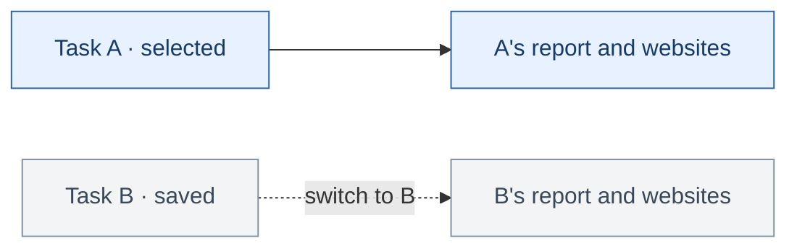
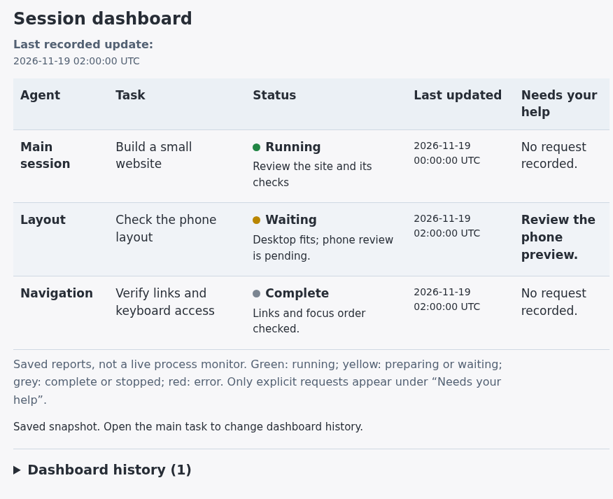
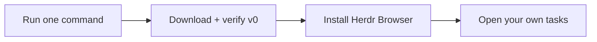

# Herdr Browser

**Keep each Herdr task beside its own websites, living reports, and dashboards.**
`v0` packages the existing Linux companion with a patched Herdr 0.9.3 client.



Switch tasks and the browser follows. Reopening a URL reuses its tab. Agents can
publish a living task page that refreshes in place, with a session overview for
switching between tasks. **Only one selected website runs in each window.**

## See the dashboard

[](https://qiyangyan.github.io/herdr-browser/dashboard.html)

**Shared dashboard: current source, after v0.** This example shows the new
dashboard with sample records. The fixed v0 installer below does not include
this later addition.
[Open the interactive example](https://qiyangyan.github.io/herdr-browser/dashboard.html).
[See the visual change summary](https://qiyangyan.github.io/herdr-browser/dashboard-update.html).

| Read | Act |
| --- | --- |
| Each task's status and recorded update time | Open its supporting report |
| **Needs your help** | See the explicit request |
| Completed work in **Dashboard history** | Restore a row or copy its task reference |

Removing a completed row keeps its report. Restoring it does not restart work.
The dashboard shows saved reports, so a green dot alone does not prove a
process is still running.

## Install v0

**Supported: Ubuntu 22.04 desktop, x86_64.** A graphical desktop is required.
Other Linux versions, ARM, macOS and Windows are not supported by this release.

```bash
curl -fsSL https://raw.githubusercontent.com/QiyangYan/herdr-browser/v0/install.sh | bash
```

For Codex users, this single command also adds the browser/report workflow to
`~/.codex/AGENTS.md` (or `$CODEX_HOME/AGENTS.md`), preserving existing instructions
and saving a backup:

```bash
curl -fsSL https://raw.githubusercontent.com/QiyangYan/herdr-browser/v0/install.sh | bash -s -- --codex
```

You can [read the installer](install.sh) before running it. It downloads the
prebuilt client and companion from the `v0` GitHub Release, verifies SHA-256
checksums, installs missing system packages using `apt`/`sudo`, and creates a
**Herdr Browser** app launcher. You do not need Rust, Zig or a Python virtualenv.
Install `curl` first if needed: `sudo apt-get install curl`.



Open **Herdr Browser** from your application menu, or run:

```bash
~/.local/bin/herdr-browser
```

The installed `herdr-browser` command also works when `~/.local/bin` is on your
`PATH`. Each person configures their own agent/model and signs into their own
accounts. This package does not include anyone else's tasks, credentials,
browser cookies or reports.

## What you get

- A native GTK terminal and one active WebKit website view per window.
- Websites associated with their originating task, with optional sections.
- Agent-published task reports, interactive figures and a session overview.
- Shared Viewed/Reviewed markers and persistent tab associations.
- Herdr-only link routing: links from other apps keep your desktop browser.
- A Browser toggle; closing the companion leaves Herdr tasks running.

[Usage and report schema](docs/usage.md) ·
[v0 visual release summary](https://qiyangyan.github.io/herdr-browser/v0.html) ·
[validation and limitations](docs/validation.md)

## Updates and local state

`v0` is a fixed snapshot. Re-running the command reinstalls that release;
future releases will have their own tags and commands. Existing app files are
saved under `~/.local/share/herdr-browser.backup-*` before replacement.
Running companions can apply installed file changes with **Apply update**.

The installer preserves ordinary `herdr`, desktop browser associations and
personal state in `~/.local/state/herdr-browser`. For a custom prefix or an
offline installation, run `bash install.sh --help`.

The app serves reports on **loopback only**. Report URLs work on the same
computer; sharing this application does not publish your reports online.

## Source and provenance

This is an independent companion, based on
[Herdr v0.9.3](https://github.com/herdrdev/herdr/tree/v0.9.3).
The `v0` app was captured from the working installed version, with private
task-specific report adapters removed and site-specific Firefox exceptions
made configurable. General browser and report features are retained.

The exact client hash and source snapshot hashes are recorded in
[`provenance.json`](herdr_browser/provenance.json).
The upstream change is in
[`patches/herdr-0.9.3-browser-context.patch`](patches/herdr-0.9.3-browser-context.patch).
Build instructions and development checks are in [DEVELOPMENT.md](DEVELOPMENT.md).

Licensed under [Apache-2.0](LICENSE). See [NOTICE](NOTICE) for upstream attribution.
